<div align="center">

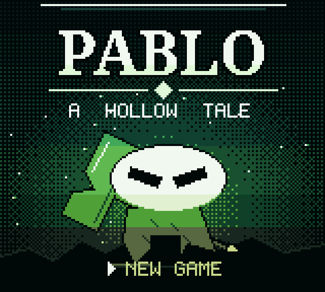

# PABLO – A Hollow Tale

**Fanowska metroidvania w klimacie *Hollow Knight* na Game Boy Color**


</div>

Mały naczynie bez imienia budzi się pod mchem Verdant Deep. Lampy gasną, bo Strażnik połknął Heartlight.
Weź swój nail, zdobądź Mothwing Cloak, przeskocz Przepaść i pokonaj Strażnika.

**7 pokoi · 1 boss · dash · leczenie (focus) · ławki z zapisem na baterii · 4 utwory muzyczne · napisy końcowe.**
Cała grafika, muzyka i dialogi są generowane proceduralnie skryptami w Pythonie.

## Pobierz i graj

Gotowy ROM: [`release/Pablo.gbc`](release/Pablo.gbc) (tylko Game Boy Color).

- **Emulator** (mGBA, SameBoy, BGB) lub **przeglądarka**: krótki poradnik w [`docs/EMULATORY.md`](docs/EMULATORY.md).
- **EverDrive GB:** skopiuj na kartę, w opcjach ROM ustaw **Mapper = MBC5**, RAM 8K, Save RAM = YES.
  Przy mapperze „ROM” ekran zostaje biały po logo.

## Sterowanie

| Przycisk | Akcja |
|---|---|
| ←/→ | ruch |
| **A** | skok (przytrzymaj = wyżej) |
| **B** | uderzenie nailem |
| **A** w powietrzu lub **SELECT** | dash (po zdobyciu Mothwing Cloak) |
| **START** (przytrzymaj) | focus – leczy maskę kosztem duszy |
| **↑** | rozmowa / odpoczynek i zapis na ławce |
| **↓** | zeskok z cienkiej platformy |

## Gameplay

| Start gry | Ruch i atak |
|:-:|:-:|
|  | 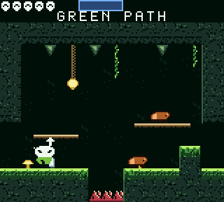 |

| Dash (A w powietrzu) przez Przepaść |
|:-:|
| 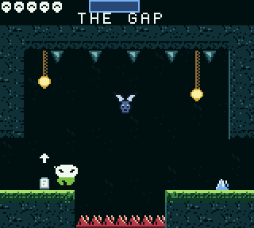 |

## Zrzuty ekranu

| | | |
|:-:|:-:|:-:|
| 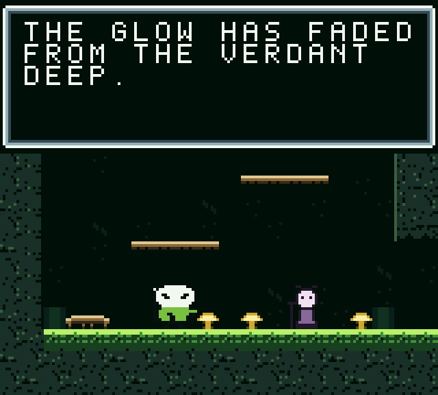 | 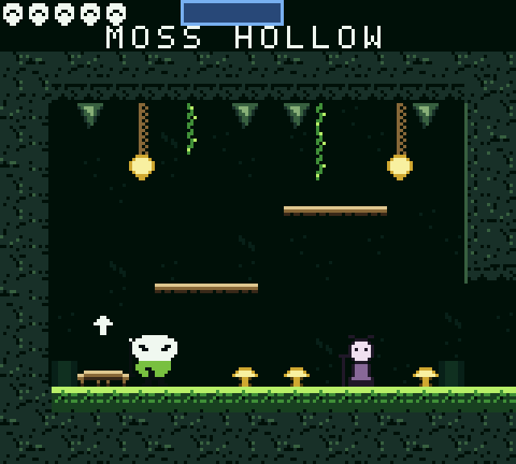 | 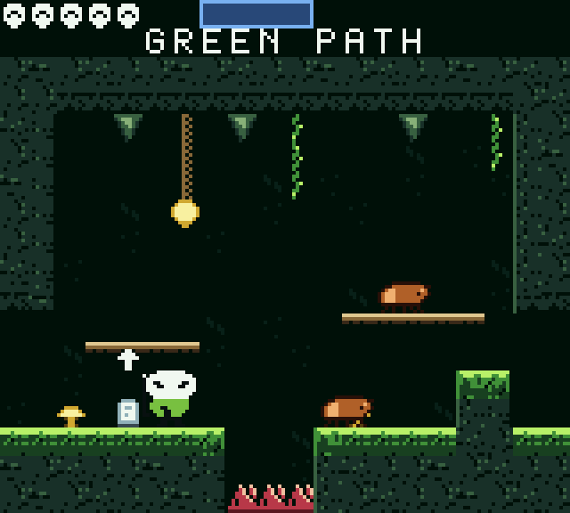 |
| Intro | Moss Hollow | Green Path |
| 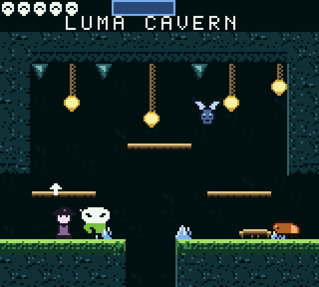 | 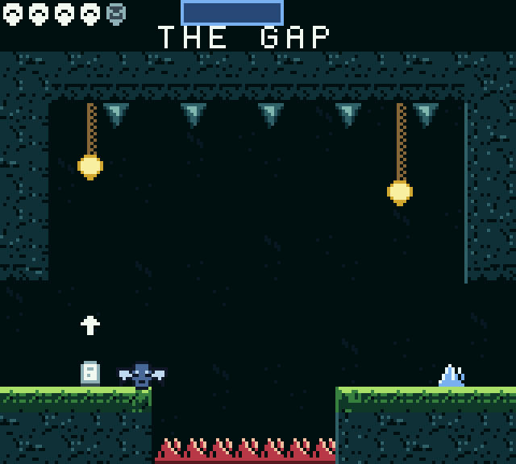 | 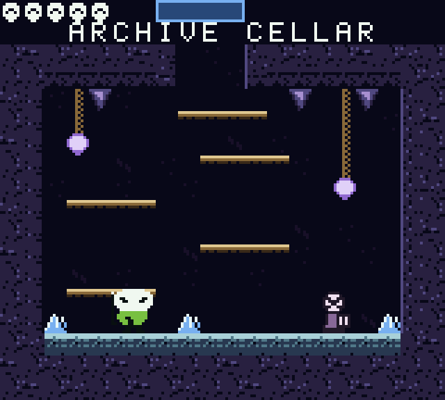 |
| Luma Cavern | The Gap | Archive Cellar |
| 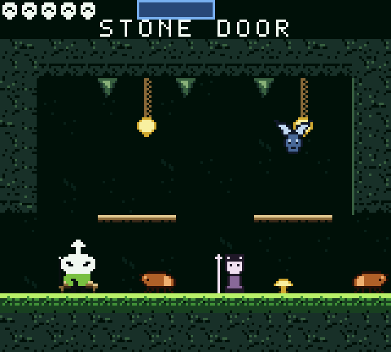 | 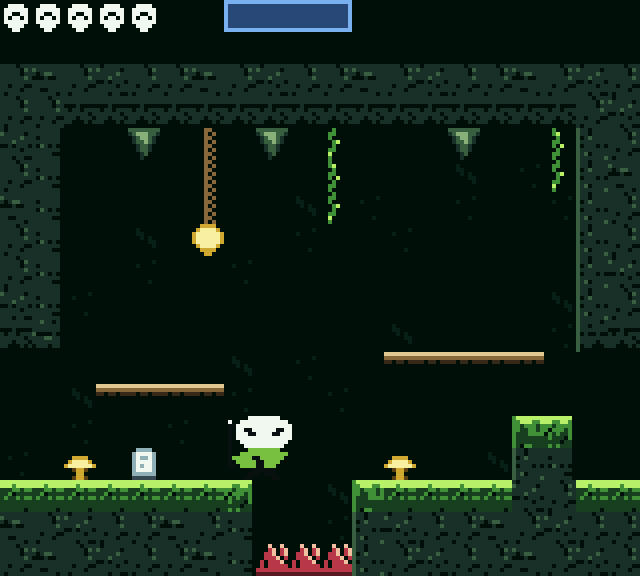 | 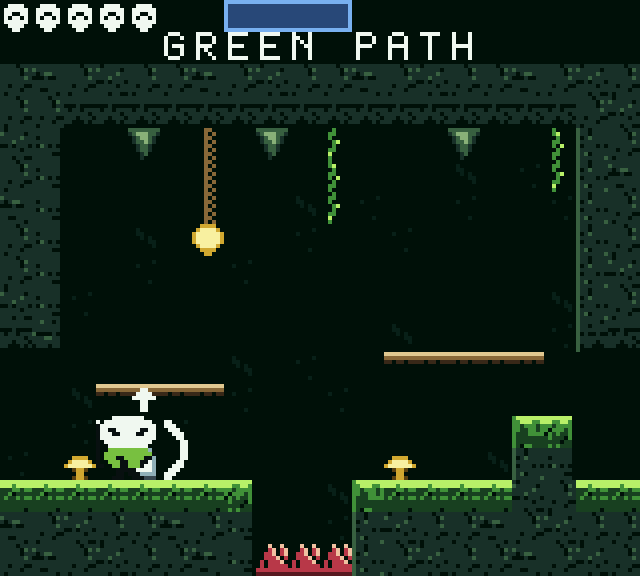 |
| Stone Door | Dash | Atak nailem |
| 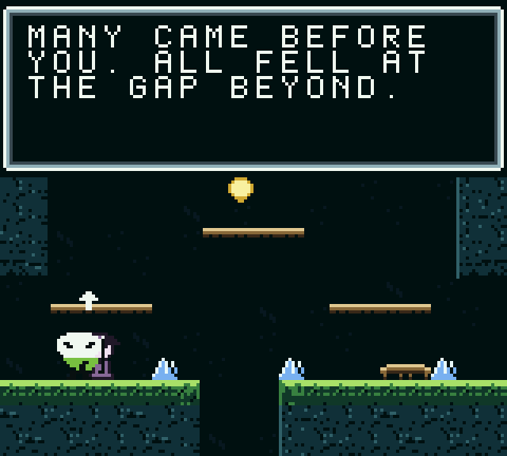 | 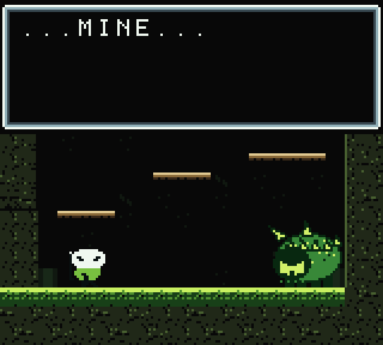 | 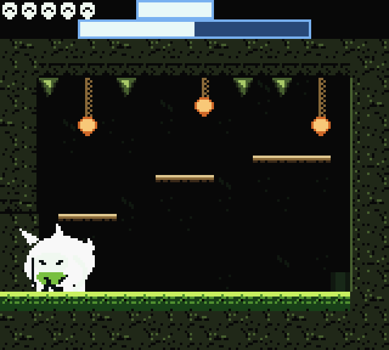 |
| Rozmowa | Boss – wstęp | Walka ze Strażnikiem |
| 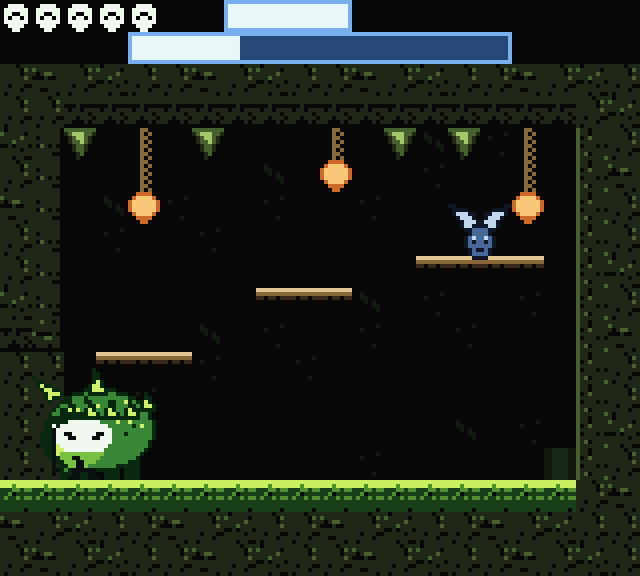 | 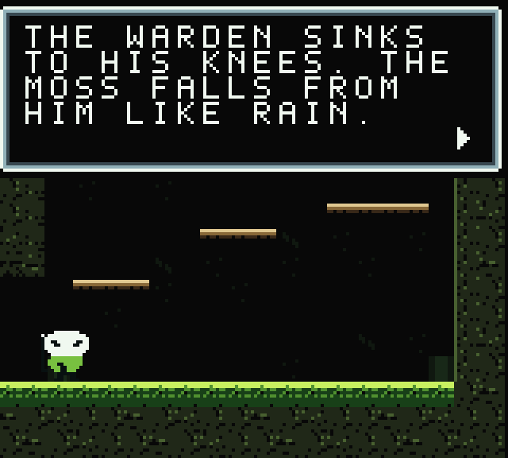 | 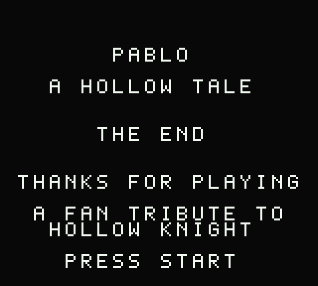 |
| Walka, faza 2 | Heartlight odzyskany | Napisy końcowe |

## Budowanie

Wymagane: [GBDK-2020](https://github.com/gbdk-2020/gbdk-2020) w `tools/gbdk`, Python 3 z Pillow i PyBoy w `.venv`.

```sh
make                       # generuje assety i buduje build/pablo.gbc
.venv/bin/python tests/t_full.py   # pełne przejście gry (headless PyBoy)
```

## Struktura

```
assets/   art.py (grafika), world.py (pokoje DSL, dialogi), music.py, build_assets.py
src/      common.c (bank 0), game.c, scenes.c, audio.c, main.c
tests/    PyBoy: pełne przejście, boss, śmierć/CONTINUE, zakończenie, lag, symulator fizyki (sim.py)
release/  gotowy ROM
```

Szczegóły techniczne: CGB-only, MBC5+RAM+BATT, 8×16 sprite'y, `cpu_fast()` dla 60 FPS, zapis w SRAM z sumą kontrolną.

## Uwaga

Projekt fanowski i niekomercyjny, niezwiązany z Team Cherry. *Hollow Knight* należy do swoich właścicieli.
